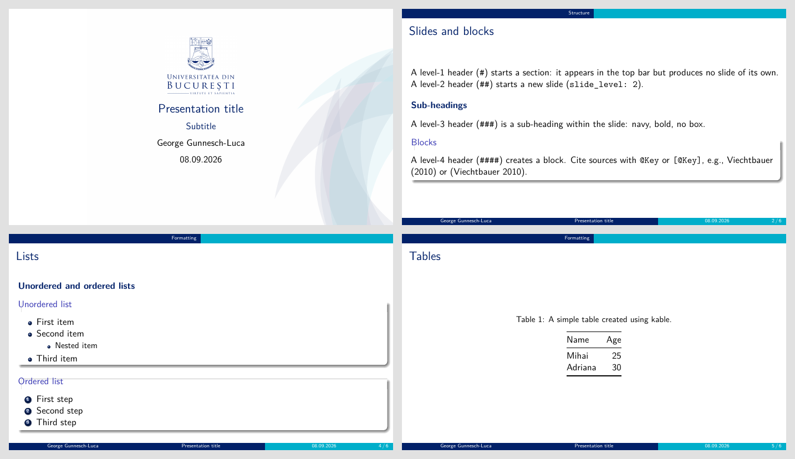

# University of Bucharest Beamer template (using R Markdown)

This repo contains my version of a Beamer template using the University of Bucharest colours, driven by R Markdown / pandoc. It is based on the CambridgeUS default and modified to match the official guidelines. It comes as a small R package, `unibucbeamer`, with two templates: one in Romanian and one in English.



## Installation

``` r
# install.packages("remotes")
remotes::install_github("GGLuca/unibuc-beamer-template")
```

You also need a functioning XeLaTeX installation (I recommend `tinytex::install_tinytex()`).

## Usage

In RStudio: **File → New File → R Markdown… → From Template**, then choose

- **Prezentare Beamer UB (română)**, or
- **UB Beamer presentation (English)**.

RStudio creates a new folder with the `.Rmd` and a `.bib` file. Knit it as it is to see the examples, then delete them and write your own content.

The YAML header is kept minimal:

``` yaml
---
title: "Presentation title"
subtitle: "Subtitle"
author: "Your Name"
date: "`r format(Sys.Date(), '%d.%m.%Y')`"
bibliography: references.bib
output: unibucbeamer::ub_presentation   # or unibucbeamer::ub_prezentare (Romanian)
---
```

All the technical setup (theme, fonts, XeLaTeX, logo, title-page artwork, colours, and the Lua filter) lives inside the package.

Without RStudio:

``` r
rmarkdown::draft("my-talk.Rmd", template = "ub-beamer-en", package = "unibucbeamer")
rmarkdown::render("my-talk/my-talk.Rmd")
```

### Options

Options go under the format name:

``` yaml
output:
  unibucbeamer::ub_presentation:
    handout: true    # handouts, no pauses/overlays
    toc: true        # table of contents after the title slide
    keep_tex: true   # keep the intermediate .tex file
```

Any other argument of `rmarkdown::beamer_presentation()` works as well. Pandoc variables set in the YAML (e.g., `lang`, `fontsize`, `aspectratio`, `urlcolor`, `toc-title`) override the package defaults. See `?unibucbeamer::ub_presentation`.

## Files

Each new presentation contains only:

- `<name>.Rmd`. The YAML header plus example slides that document the conventions.
- `referinte.bib` / `references.bib`. The bibliography file (BibTeX).

The shared files live in the package, in `inst/resources/`:

- `presentation_setup.tex`. This contains the colours, title page, logo, background, and the `\subheading{}` macro.
- `headings.lua`. The pandoc filter where I modified the level-3 headers to become sub-headings. Level-4 headers become blocks.
- `logo.png`. The UB Logo (only on the title page).
- `background.png`. Some title-page artwork I found on the official .PPT file.

The output format is defined in `R/ub_presentation.R`, and the templates in `inst/rmarkdown/templates/`.

## Basics

- `# Title` Creates a section (but no section slide is produced).
- `## Title` This is a new slide.
- `### Title` Sub-heading inside a slide.
- `#### Title` Creates a block inside a slide.
- Citations. Classic BibTeX citations. Use `@Key` or `[@Key]` with keys from the `.bib` file (one example entry, `Viechtbauer2010`); the list is printed on the last slide.
- Tables. Use `knitr::kable()` in an R chunk with `echo=FALSE`. But of course, Markdown tables work as well.
- Language. `ub_prezentare` uses Romanian labels (e.g., "Tabel", "Cuprins"), `ub_presentation` British English. `lang:` in the YAML overrides this.

## Keynote

A Keynote theme with the same design is in `Keynote (MacOS)/`. It is not part of the R package; download it from the repo.

## License

The code and text are MIT-licensed (see `LICENSE.md`). The University of Bucharest logo and title-page artwork are not covered by this license; they belong to the University of Bucharest.
